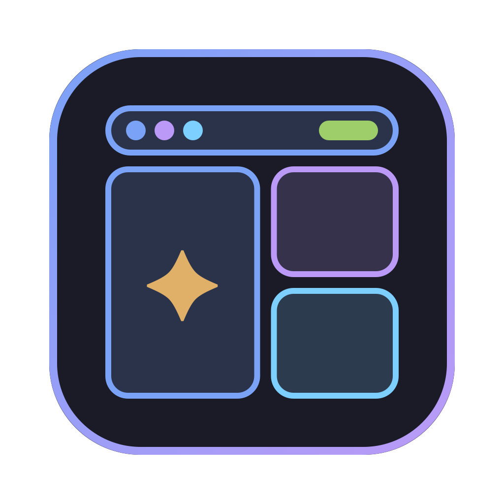

<p align="center">
  
</p>

<h1 align="center">Rice Studio</h1>

<p align="center">Pencere yöneticisi + bar ikilisini tek yerden yönet · macOS 14+</p>

<p align="center">
  <a href="https://github.com/bahayavas/rice-studio/releases/latest/download/RiceStudio-macOS.zip"></a>
  <a href="https://github.com/bahayavas/rice-studio/releases/latest"></a>
</p>

## Kurulum

1. Yukarıdaki **İndir** düğmesiyle `RiceStudio-macOS.zip` dosyasını indir (ya da sağdaki **Releases** bölümünden istediğin sürümü seç).
2. Zip'i aç, `Rice Studio.app`'i **Uygulamalar** klasörüne sürükle.
3. Uygulama Apple tarafından imzalanmadığı için ilk açılışta macOS uyarı verebilir:
   uygulamaya **sağ tık → Aç** de, ya da Terminal'de şunu çalıştır:
   ```sh
   xattr -cr "/Applications/Rice Studio.app"
   ```

Kaynaktan derlemek için aşağıdaki **Derleme** bölümüne bak.

---


WM Switcher + Bar Switcher'ın birleşimi: aynı anda 1 pencere yöneticisi + 1 bar, her biri için özelleştirme.
**Durum: aşama 1/5** (iskelet, modül protokolü, Swift geçiş mantığı, CLI). Ana pencere, Dock menüsü ve
kısayollar aşama 2'de, özelleştirme ekranları 3-4'te, profiller ve yedekler 5'te geliyor.

## CLI

`rice`, uygulama binary'sine giden bir symlink (`~/.local/bin/rice → /Applications/Rice Studio.app/Contents/MacOS/RiceStudio`).

```
rice status                  aktif WM, bar ve tüm modüllerin durumu
rice wm <id|none|next>       pencere yöneticisi seç (diğerleri kapanır)
rice bar <id|none|next>      bar seç (diğerleri kapanır, menü barı ayarlanır)
rice off                     WM ve barı kapat (normal macOS)
rice start|stop|restart <id> tek modül (WM/bar için start = aktif yap)
rice reload <id>             config'i yeniden yükle (AeroSpace reload-config, sketchybar --reload, bordersrc)
rice restore                 kayıtlı WM + barı geri yükle
rice config <id>             config dosyasının yolu
rice list                    modül id'leri
```

WM: `aerospace`, `amethyst`, `hyprmac` · Bar: `sketchybar`, `barik`, `simplebar`, `ubersicht`, `zebar` · Ekstra: `borders`

## Geçiş kuralları

- Seçilmeyenler kapanır: uygulamalara normal Quit (`NSRunningApplication.terminate`, AppleScript izni
  gerekmez) → 3 sn → `TERM` → 1 sn → `KILL`. SketchyBar'a `TERM`.
- Seçilen zaten tek başına açıksa hiçbir şey yapılmaz.
- simple-bar ↔ Übersicht: aynı süreç kapanmaz, yalnızca widget'ların `hidden` ayarı değişir (silinmez).
  Übersicht Quit'i yok sayar, `TERM` ile kapanır; öksüz kalan node widget sunucusu da kapatılır.
- Bar seçiliyse macOS menü barı otomatik gizlenir (`_HIHideMenuBar`), "none"da geri gelir. İlk değişiklikten
  önceki değer `~/.config/rice-studio/menubar.backup`'ta. Kapatmak için `settings.json` → `"manageMenuBar": false`.
- Uygulama ve CLI aynı anda geçiş yapmasın diye `~/.config/rice-studio/.lock` (flock, 20 sn bekler).
- JankyBorders `brew services` ile çalışıyorsa (launchd `KeepAlive`), durdurma `launchctl bootout` ile yapılır.

## Dosyalar

```
~/.config/rice-studio/settings.json   ayarlar (elle düzenlenebilir)
~/.config/rice-studio/state.json      seçili WM / bar / profil (ilk açılışta eski switcher'lardan devralındı)
~/.config/rice-studio/rice.log        geçiş günlüğü
~/.rice-studio/backups/               config yedekleri (ilk yedek: 20261023-011627-initial)
```

## Yeni modül eklemek

1. `Sources/RiceStudio/Modules/X.swift`: çoğu zaman `AppModule` (.app) ya da `BinaryModule` (tek program)
   alt sınıfı yeterli:
   ```swift
   final class XModule: AppModule {
       init() {
           super.init(id: "x", name: "X", kind: .bar, badge: "X", symbol: "menubar.rectangle",
                      bundleID: "com.example.x", appPath: "/Applications/X.app", installHint: "brew install --cask x")
       }
       override var configPath: URL? { homeURL(".config/x/config.toml") }
       // isteğe bağlı: override func reload(), validateConfig(_:), backupPaths, customizationView
   }
   ```
2. `Modules/Registry.swift` → `all` listesine `XModule()` ekle, `./build.sh`.

Protokol (`Core/Module.swift`): `isInstalled`, `isRunning()`, `start()`, `stop()`, `restart()`, `reload()`,
`configPath`, `backupPaths`, `readConfig()`, `writeConfig(_:)`, `validateConfig(_:)`, `customizationView`.

## Derleme

```
./build.sh               # → /Applications/Rice Studio.app + ~/.local/bin/rice
./build.sh --no-install
```

## Lisans

[MIT](LICENSE) © 2026 Baha Yavaş
